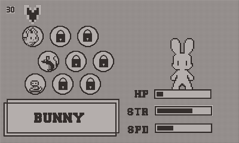

# Bunnyball

A 1v1 ball game for the [Playdate](https://play.date/), inspired by
[Penguin Wars](https://en.wikipedia.org/wiki/Penguin_Wars) on the Game Boy.

Grab balls and throw them at your opponent to deplete their health before they do the same to you.

Three tournaments of increasing difficulties to play through and 9 playable critters to unlock.

## Play

[Sideload](https://help.play.date/developer/sideloading/) `Bunnyball.pdx` onto your Playdate or use the [Playdate simulator](https://play.date/dev/)

### Controls

- Left / Right to move
- B to dash
- A to pick up a ball
- Hold A to charge and release to throw

## Credits

- Core code by [Gareth](https://github.com/GarethMurden/), with 2026 bug fixes & tidy up by LLM
- Art by [KuroganeNiello](https://www.instagram.com/kuroganeniello/)
- Music from [Dedediego](https://dedediego.itch.io/)
- Special thanks to Toad and PizzaDev from the PlaydateSquad Discord

